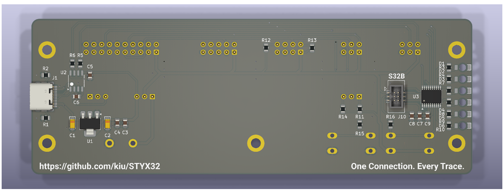
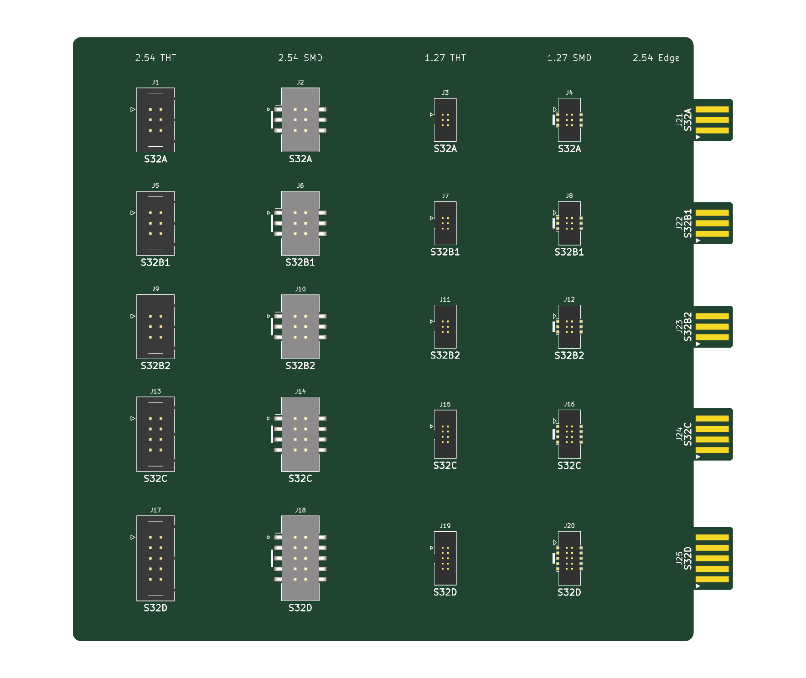

# STYX32
STYX32 - STM32 In-Circuit-Programming

# Connectors
STYX32 puts every programming and debug connection on the same pinout. Target boards use one of
these headers; pins 1, 3 and 5 are always 3V3, RESET (GND on D) and GND.

| Marking | Header | 1 | 2 | 3 | 4 | 5 | 6 | 7 | 8 | 9 | 10 |
|---|---|---|---|---|---|---|---|---|---|---|---|
| S32A | 2x3 serial | 3V3 | TX | RESET | RX | GND | BOOT0 | | | | |
| S32B1 | 2x3 SWD + serial | 3V3 | SWDIO | RESET | SWDCLK | GND | TX | | | | |
| S32B2 | 2x3 SWD + SWO | 3V3 | SWDIO | RESET | SWDCLK | GND | SWO | | | | |
| S32C | 2x4 SWD + SWO + serial | 3V3 | SWDIO | RESET | SWDCLK | GND | SWO | TX | RX | | |
| S32D | 2x5 ARM Cortex debug | 3V3 | SWDIO | GND | SWDCLK | GND | SWO | KEY | TDI | GND | RESET |

TX and RX are seen from the target: TX is the target's output.

## KiCad library
[lib/](lib/) has a symbol and a footprint for every connector in four variants (2.54 mm and
1.27 mm pitch, SMD and THT), named `STYX32_<connector>_2x<rows>_<pitch>_<SMD|THT>`. The symbols
look like KiCad's generic 2-row connectors, link their footprint and carry the LCSC part number.
The footprints show the marking (e.g. S32B2), a pin 1 mark and the key notch on the silkscreen,
and the pin names on F.Fab.

Every connector also comes as a card edge, `STYX32_<connector>_2x<rows>_P2.54mm_Edge`: gold
fingers on both sides of a 1.6 mm board (odd pins on top, even pins below them) that plug into a
2.54 mm edge slot socket, e.g. WingTAT ED06BGFBK / ED08BGFBK / ED10BGFBK (LCSC C5173287 / C5173288 /
C5173289, in the symbol's `Mate` field). The socket has no key: a triangle on top and a square on
the bottom mark the pin 1 end. The footprint brings the card outline on Edge.Cuts; join its two
ends to your board edge, straight across for a card sticking out of the board, or along the notch
guide on User.Drawings for a card cut into the board. The plugged socket is drawn on User.Drawings
beyond the card edge. Card edges are not part of the BOM; ENIG is fine, a bevelled edge plugs in
more easily.

The [template](lib/template/) schematic has every connector wired to global labels
(`STM_SWDIO`, `STM_SWDCLK`, `STM_SWO`, `STM_RESET`, `STM_TX`, `STM_RX`, `STM_BOOT0`, `STM_TDI`),
`+3V3` and `GND`: copy a connector with its labels into your own schematic.

1. Add `lib/STYX32.kicad_sym` and `lib/STYX32.pretty` to your symbol and footprint library tables
   (nickname `STYX32`).
2. For the 1.27 mm 3D models, set the path variable `STYX32_LIB` to the `lib` folder
   (Preferences > Configure Paths).

The whole library is generated by [lib/tools/](lib/tools/): `gen_symbols.py` (any Python),
`gen_footprints.py` (KiCad's Python) and `make_3d.py` (FreeCAD) for the 1.27 mm models.

# Files
- [main](REV_A/main/): KiCad schematic, board and gerbers
- [template](lib/template/): KiCad project showing every connector of the library
- [lib](lib/): KiCad symbol and footprint library for the connectors
- [BOM](REV_A/STYX32-bom.ods): Bill of materials [(PDF)](REV_A/STYX32-bom.pdf)
- [firmware](firmware/): STM32CubeIDE project

# Links
- [IDCto127](https://github.com/kiu/IDCto127)

# License
This project is licensed under the Creative Commons Attribution-NonCommercial 3.0 Unported (CC BY-NC 3.0) license.
