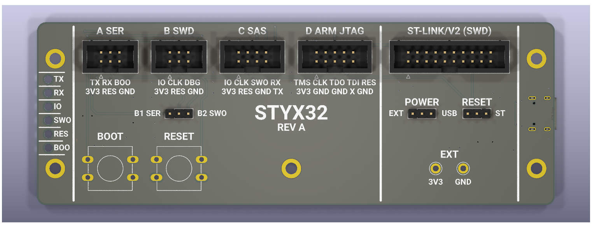

# STYX32
STYX32 - STM32 In-Circuit-Programming

# Files
- [kicad](REV_A/kicad/): KiCad schematic, board and gerbers
- [BOM](REV_A/STYX32-bom.ods): Bill of materials [(PDF)](REV_A/STYX32-bom.pdf)
- [firmware](firmware/): STM32CubeIDE project

# Links
- [IDCto127](https://github.com/kiu/IDCto127)

# License
This project is licensed under the Creative Commons Attribution-NonCommercial 3.0 Unported (CC BY-NC 3.0) license.
